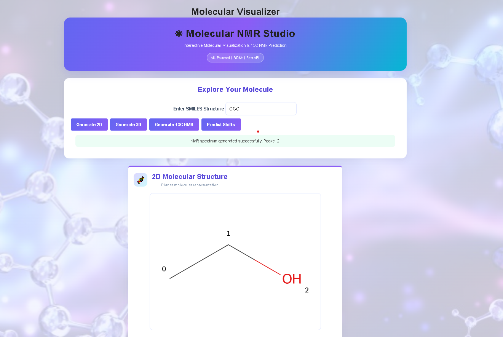
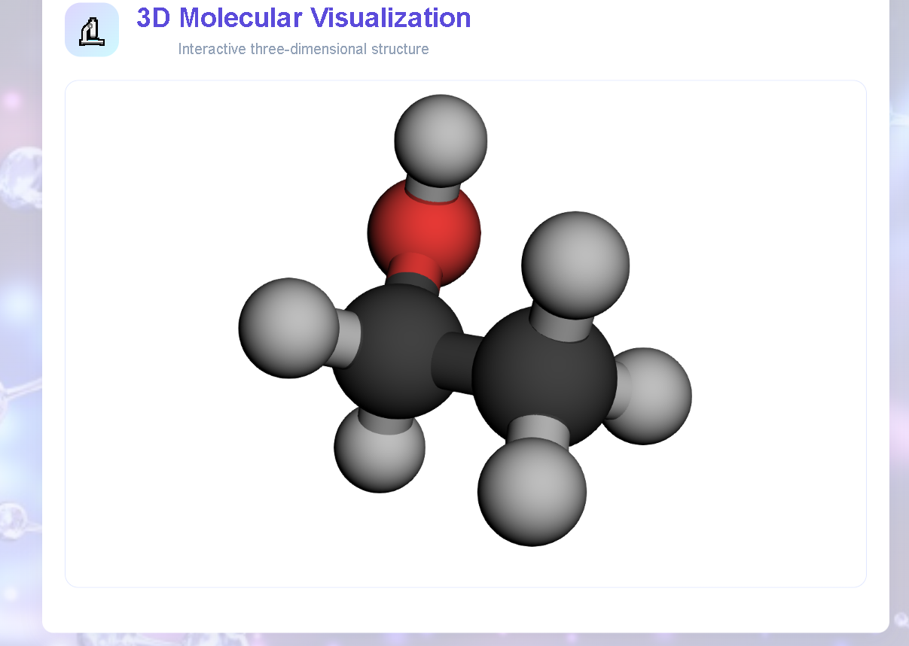
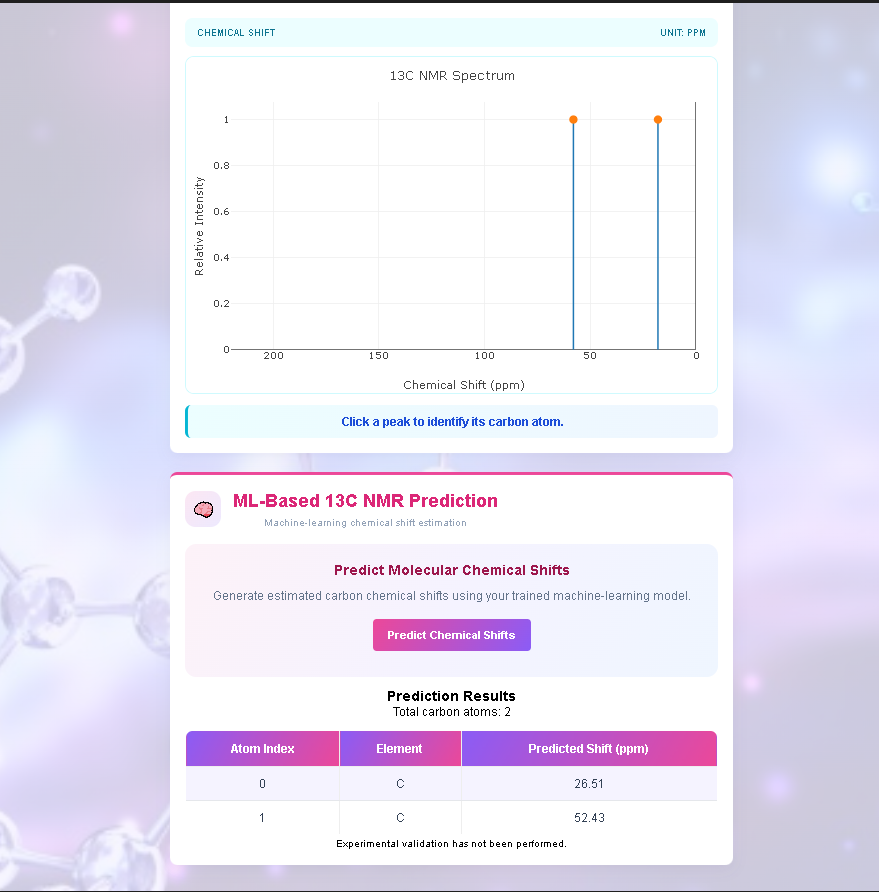

Molecular 3D NMR Predictor

Project Overview

This project implements a machine learning-based prediction system using Python.It demonstrates data generation, model training,decision tree 
implementation,model comparision,and prediction.

The objective is to build a complete machine learning workflow and make predictions using trained models.

Probelm Statement
Develop a machine learning system that learns patterns from structured
data nad uses those patterns to make predictions.

Features

- Generate 2D molecular structures.
- Generate interactive 3D molecular structures.
- Extract molecular and atomic features using RDKit.
- Visualize ¹³C NMR spectra.
- Identify carbon atoms by clicking spectrum peaks.
- Predict carbon chemical shifts using machine learning.
- Compare Linear Regression, Decision Tree and Random Forest models.

Technologies Used

- Python
- FastAPI
- RDKit
- Scikit-learn
- Pandas
- Matplotlib
- Plotly
- HTML, CSS and JavaScript

Machine Learning Results

Model| MAE (ppm)| RMSE (ppm)
Linear Regression| 22.551| 27.857
Decision Tree| 35.571| 42.088
Random Forest| 16.705| 22.659

Important: These results come from a small synthetic dataset of five molecules. They are demonstration results, not evidence of experimental predictive accuracy.

Dataset

The initial dataset contains manually assigned illustrative chemical shifts. It is synthetic and should not be treated as experimental NMR data.

Activate the environment on Windows:

.venv\Scripts\activate

Install dependencies:

pip install fastapi uvicorn rdkit pandas scikit-learn joblib matplotlib plotly

Run the application:

python -m uvicorn main:app --reload

Open the frontend using VS Code Live Server.

Future Improvements

- Build a larger experimental ¹³C NMR dataset.
- Improve chemical shift prediction accuracy.
- Add experimental validation.
- Deploy the application online.

Project Status

Portfolio demonstration project. Scientific validation is ongoing.

## Application Screenshots

### Main Dashboard

### 3D Molecular Visualization

### 13C NMR Spectrum

